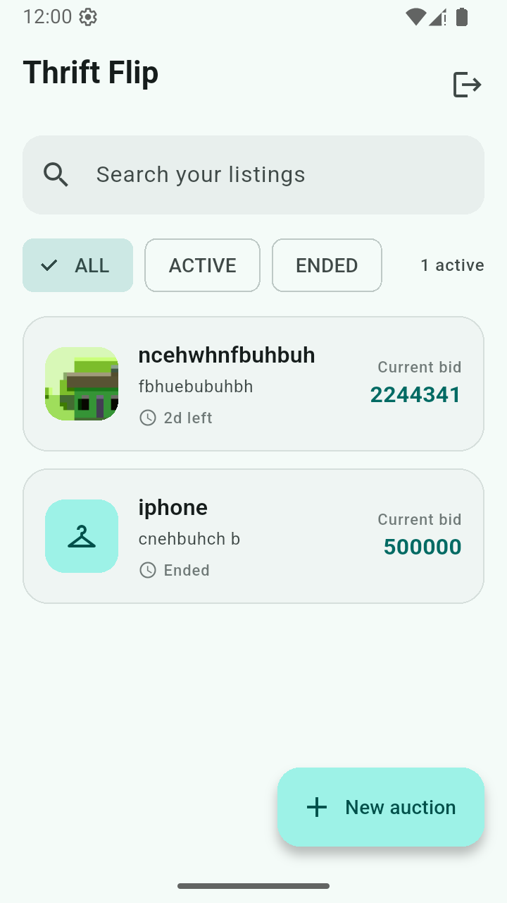
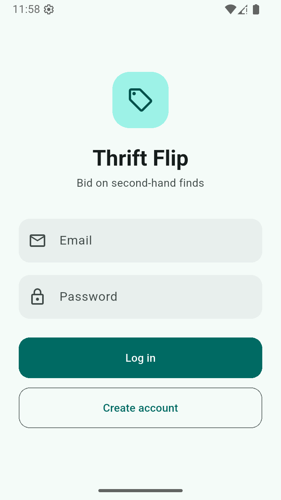
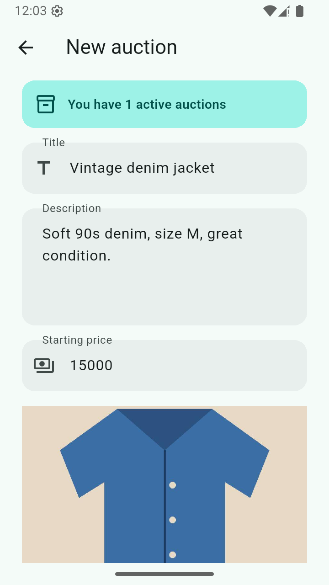

# Thrift Flip

List second-hand clothes for auction, with a photo of each item, and watch your listings update live on any phone you log in from.

## Download

[Download the APK](https://github.com/ruthiz18/thrift_flip/releases/download/v1.0.0/app-arm64-v8a-release.apk) (for Android phones)

Or see all versions on the [Releases page](https://github.com/ruthiz18/thrift_flip/releases).

## Features

- Create an account and log in
- Create, edit and delete your auctions, each with a photo from the camera or gallery
- Filter auctions (all, active, ended) and search by title or description
- Live updates: a change shows up on every phone at once
- Your listings are tied to your account

## Screenshots

| Login | My listings | New auction |
|---|---|---|
|  |  |  |

## How it's built

- Flutter, with Provider for state management
- Firebase Authentication and Cloud Firestore; photos on Cloudinary
- Four layers: models, repositories, state, screens

## Run it yourself

1. Clone the repository and run `flutter pub get`.
2. Connect your own Firebase project (`google-services.json`).
3. Put your Cloudinary cloud name and upload preset in
   `lib/repositories/photo_repository.dart`.
4. `flutter run`

## Author

Ruth Izukondi: [GitHub](https://github.com/ruthiz18)
